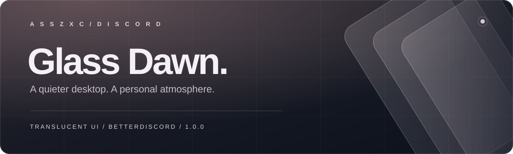

<p align="center">
  
</p>

<h1 align="center">asszxc / Glass Dawn</h1>

<p align="center">
  A translucent Discord interface. Make it your own.
</p>

<p align="center">
  <a href="https://raw.githubusercontent.com/Meldixx/asszxc-discord/main/asszxc.theme.css"></a>
  <a href="https://raw.githubusercontent.com/Meldixx/asszxc-discord/main/asszxcSettings.plugin.js"></a>
</p>

<p align="center">
  <a href="https://github.com/Meldixx/asszxc-discord/stargazers"></a>
  <a href="https://github.com/Meldixx/asszxc-discord/issues"></a>
  <a href="LICENSE"></a>
  <a href="https://betterdiscord.app/"></a>
</p>

<p align="center">
  <strong>English</strong> · <a href="README.ru.md">Русский</a>
  &nbsp;·&nbsp; <a href="https://github.com/Meldixx/asszxc-discord/issues">Support</a>
  &nbsp;·&nbsp; <a href="https://github.com/Meldixx/asszxc-discord/releases">Releases</a>
</p>

---

## Design

Glass Dawn brings soft blur, translucent surfaces and muted colors to Discord. Choose your own wallpaper or keep the original appearance, and customize the interface without editing CSS through the optional **asszxc Settings** plugin.

| Glass interface | Personal atmosphere |
| :--- | :--- |
| Translucent channels, DMs, profiles and settings | Wallpaper, tint, dimming and saturation |
| Soft borders and minimal controls | Custom panel colors and transparency |
| Animated Orbitron wordmark | 46 settings with English and Russian support |

## Download & install

Both components are available directly from GitHub. The theme can be used without the settings plugin.

<details open>
<summary><strong>01 — Install the theme</strong></summary>

1. Install [BetterDiscord](https://betterdiscord.app/).
2. Download [`asszxc.theme.css`](https://raw.githubusercontent.com/Meldixx/asszxc-discord/main/asszxc.theme.css).
3. In Discord, open **User Settings → BetterDiscord → Themes → Open Themes Folder**.
4. Move the CSS file into that folder and enable **asszxc**.
5. Disable conflicting themes if necessary.

</details>

<details>
<summary><strong>02 — Install the settings plugin (optional)</strong></summary>

1. Download [`asszxcSettings.plugin.js`](https://raw.githubusercontent.com/Meldixx/asszxc-discord/main/asszxcSettings.plugin.js).
2. Open **User Settings → BetterDiscord → Plugins → Open Plugins Folder**.
3. Move the JS file into that folder and enable **asszxc Settings**.
4. Open the gear icon on the plugin card to customize the theme.

</details>

<details>
<summary><strong>03 — Update or reinstall</strong></summary>

Download the current files using the buttons above, replace the existing files in their respective folders, then reload Discord with `Ctrl + R`. Keep a backup of any manual CSS changes.

</details>

## Make it yours

The plugin exposes 46 settings in four categories. Changes apply live while the theme is enabled and are stored locally.

| Category | What you can change |
| :--- | :--- |
| **Background** | HTTPS wallpaper URL, local image (up to 8 MB), position, scale, tint and dimming |
| **Glass** | Window blur, menu blur, saturation |
| **Panels** | Surface colors, opacity, borders, hover and selection, scrollbar opacity |
| **Colors** | Text, links, focus, accent and button colors |

Use **Reset all settings** to restore the defaults. For advanced customization, edit the variables at the top of the CSS file. Layout and logo settings are intentionally not exposed in the plugin.

<details>
<summary>Manual CSS customization</summary>

Edit the `:root` block in `asszxc.theme.css`. For example:

```css
--az-blur: 6px;
--az-popup-blur: 14px;
--az-glass-opacity: .12;
--az-sidebar-opacity: .18;
--az-accent: #c6bcc7;
```

These are the default values. If a setting has been changed in the plugin, its saved override takes precedence.

</details>

## Support & compatibility

Found an issue? Open a [GitHub issue](https://github.com/Meldixx/asszxc-discord/issues/new) with your Discord and BetterDiscord versions, a description of the affected screen and a screenshot without personal information.

> [!NOTE]
> Glass Dawn is designed for BetterDiscord desktop. Discord updates can affect CSS selectors; live-client compatibility of this release still needs verification. The companion plugin is not designed for Vencord.

<details>
<summary>Privacy and external resources</summary>

The plugin has no analytics or telemetry and does not collect messages or account data. Preferences and local images are stored through BetterDiscord's local data API. Remote wallpapers and fonts are fetched from their respective hosts. See [third-party resources](THIRD-PARTY.md), including the pending verification of the default wallpaper's rights.

</details>

<details>
<summary>Development checks</summary>

```sh
node --check asszxcSettings.plugin.js
node --test tests/settings.test.cjs
```

</details>

## Project

Maintained by [asszxc / Meldixx](https://github.com/Meldixx). The project is distributed independently through GitHub.

The [MIT license](LICENSE) covers original project code for which the distributor holds the necessary rights. External resources have separate terms; see [THIRD-PARTY.md](THIRD-PARTY.md). This project is not affiliated with Discord or BetterDiscord, is not approved by the official BetterDiscord catalog, and the current implementation does not meet the catalog's authorship requirements.

---

<p align="center">
  <strong>asszxc / Glass Dawn</strong><br>
  <sub>Version 1.0.0 · <a href="LICENSE">MIT</a> · <a href="README.ru.md">Русский</a></sub>
</p>
