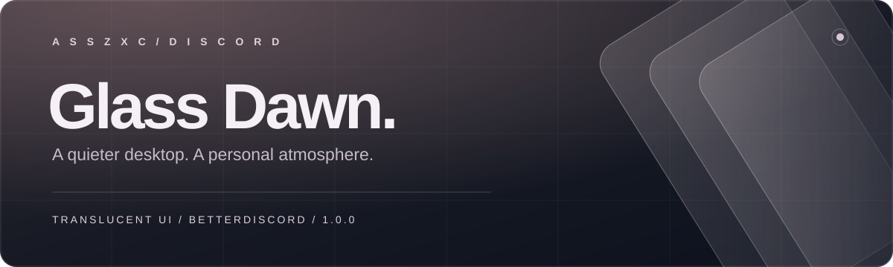

<p align="center">
  
</p>

<h1 align="center">asszxc / Glass Dawn</h1>

<p align="center">
  Стеклянный интерфейс Discord. Настрой его под себя.
</p>

<p align="center">
  <a href="https://raw.githubusercontent.com/Meldixx/asszxc-discord/main/asszxc.theme.css"></a>
  <a href="https://raw.githubusercontent.com/Meldixx/asszxc-discord/main/asszxcSettings.plugin.js"></a>
</p>

<p align="center">
  <a href="https://github.com/Meldixx/asszxc-discord/stargazers"></a>
  <a href="https://github.com/Meldixx/asszxc-discord/issues"></a>
  <a href="LICENSE"></a>
  <a href="https://betterdiscord.app/"></a>
</p>

<p align="center">
   <a href="README.md">English</a> · <strong>Русский</strong>
  &nbsp;·&nbsp; <a href="https://github.com/Meldixx/asszxc-discord/issues">Поддержка</a>
  &nbsp;·&nbsp; <a href="https://github.com/Meldixx/asszxc-discord/releases">Релизы</a>
</p>

---

## Дизайн

Glass Dawn объединяет мягкое размытие, полупрозрачные поверхности и спокойную палитру Discord. Установи собственные обои или оставь стандартное оформление, а с помощью дополнительного плагина **asszxc Settings** настраивай интерфейс без редактирования CSS.

| Стеклянный интерфейс | Индивидуальное оформление |
| :--- | :--- |
| Прозрачные каналы, ЛС, профили и настройки | Обои, оттенки, затемнение и насыщенность |
| Мягкие границы и минималистичные элементы | Цвета и прозрачность панелей |
| Анимированный логотип Orbitron | 46 настроек на русском и английском |

## Скачать и установить

Оба компонента доступны напрямую с GitHub. Тему можно использовать без плагина настроек.

<details open>
<summary><strong>01 — Установка темы</strong></summary>

1. Установи [BetterDiscord](https://betterdiscord.app/).
2. Скачай [`asszxc.theme.css`](https://raw.githubusercontent.com/Meldixx/asszxc-discord/main/asszxc.theme.css).
3. Открой **Настройки пользователя → BetterDiscord → Темы → Открыть папку тем**.
4. Перемести CSS-файл в эту папку и включи **asszxc**.
5. При необходимости отключи конфликтующие темы.

</details>

<details>
<summary><strong>02 — Установка плагина настроек (необязательно)</strong></summary>

1. Скачай [`asszxcSettings.plugin.js`](https://raw.githubusercontent.com/Meldixx/asszxc-discord/main/asszxcSettings.plugin.js).
2. Открой **Настройки пользователя → BetterDiscord → Плагины → Открыть папку плагинов**.
3. Перемести JS-файл в эту папку и включи **asszxc Settings**.
4. Нажми шестерёнку на карточке плагина для настройки темы.

</details>

<details>
<summary><strong>03 — Обновление или переустановка</strong></summary>

Скачай актуальные файлы по кнопкам выше, замени существующие файлы в соответствующих папках и перезагрузи Discord сочетанием `Ctrl + R`. Сохрани копию ручных изменений CSS, если они есть.

</details>

## Настрой под себя

В плагине доступно 46 параметров, разделённых на четыре категории. Изменения применяются сразу, пока тема включена, и сохраняются локально.

| Категория | Что можно изменить |
| :--- | :--- |
| **Фон** | HTTPS-ссылка на обои, локальный файл до 8 МБ, положение, масштаб, оттенок и затемнение |
| **Стекло** | Размытие окна и меню, насыщенность |
| **Панели** | Цвета поверхностей, прозрачность, границы, наведение, выделение и полоса прокрутки |
| **Цвета** | Текст, ссылки, фокус, акценты и цвета кнопок |

Кнопка **Сбросить всё** возвращает стандартное оформление. Для расширенной настройки можно менять переменные в начале CSS-файла. Компоновка и логотип намеренно не вынесены в настройки плагина.

<details>
<summary>Ручная настройка CSS</summary>

Редактируй блок `:root` в файле `asszxc.theme.css`. Например:

```css
--az-blur: 6px;
--az-popup-blur: 14px;
--az-glass-opacity: .12;
--az-sidebar-opacity: .18;
--az-accent: #c6bcc7;
```

Это стандартные значения. Если параметр изменён в плагине, его сохранённое значение имеет приоритет.

</details>

## Поддержка и совместимость

Нашёл ошибку? Создай [GitHub issue](https://github.com/Meldixx/asszxc-discord/issues/new), укажи версии Discord и BetterDiscord, опиши проблемный раздел и приложи скриншот без личных данных.

> [!NOTE]
> Glass Dawn предназначен для настольного BetterDiscord. Обновления Discord могут менять CSS-селекторы; совместимость этого релиза в реальном клиенте ещё требует проверки. Плагин настроек не предназначен для Vencord.

<details>
<summary>Конфиденциальность и внешние ресурсы</summary>

Плагин не содержит аналитики и телеметрии, не собирает сообщения или данные аккаунта. Настройки и локальные изображения хранятся через локальный API BetterDiscord. Внешние обои и шрифты загружаются с соответствующих серверов. Подробнее — [сторонние ресурсы](THIRD-PARTY.md), в том числе сведения о необходимости проверки прав на стандартные обои.

</details>

<details>
<summary>Проверка исходников</summary>

```sh
node --check asszxcSettings.plugin.js
node --test tests/settings.test.cjs
```

</details>

## Проект

Разработчик и сопровождающий проекта — [asszxc / Meldixx](https://github.com/Meldixx). Проект распространяется независимо через GitHub.

[Лицензия MIT](LICENSE) распространяется на оригинальный код, на который у распространителя имеются необходимые права. Внешние ресурсы используются на собственных условиях; см. [THIRD-PARTY.md](THIRD-PARTY.md). Проект не связан с Discord или BetterDiscord, не одобрен официальным каталогом BetterDiscord, а текущая реализация не соответствует требованиям каталога к авторству.

---

<p align="center">
  <strong>asszxc / Glass Dawn</strong><br>
  <sub>Версия 1.0.0 · <a href="LICENSE">MIT</a> · <a href="README.md">English</a></sub>
</p>
